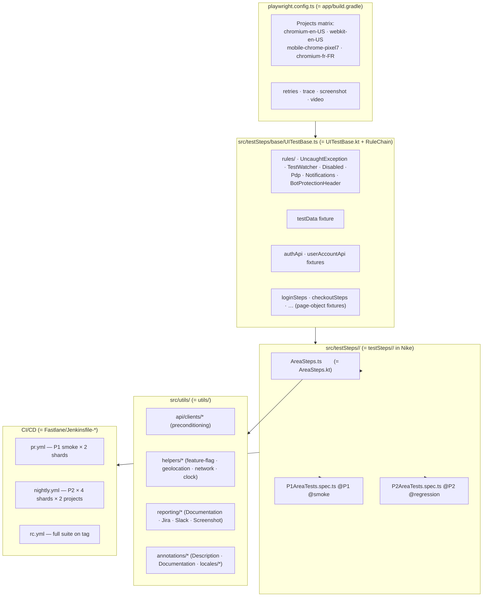

# Playwright E-Commerce Automation Framework

> Industry-grade Playwright + TypeScript framework whose **code structure mirrors the Nike App Android automation suite 1:1** (`testSteps/<area>/<AreaSteps|P1AreaTests|P2AreaTests>`, `base/UITestBase + base/rules/`, `utils/{annotations, api/clients, helpers, reporting}`, `resources/`, `testSuites/`).
> Target application under test: **[automationexercise.com](https://automationexercise.com)** (full storefront + public REST API).


---

## Why this framework exists

I built this to demonstrate that the mobile-automation architecture I run at Nike (Kotlin + Espresso + Compose on Android, Swift + XCUITest on iOS) **translates directly to web** without losing any of the senior-SDET patterns: layered fixtures, API-driven preconditioning, cross-browser × locale project matrices, sharded CI, visual + a11y + perf coverage, and custom reporters wired to Jira / Slack.

Every Nike file has a named counterpart here — see `docs/architecture.md`.

## Architecture



## Repo layout (1:1 mirror of the Nike Android suite)

```text
src/
├── accessibility/                 = accessibility/
├── resources/                     = resources/   (TestData, TestAccount, strings/<locale>.json)
├── testSteps/
│   ├── base/                      = base/
│   │   ├── UITestBase.ts          = UITestBase.kt
│   │   ├── PlaywrightFailureHandler.ts = EspressoFailureHandler.kt
│   │   └── rules/                 = base/rules/
│   │       ├── UncaughtExceptionRule.ts    = CoroutineExceptionHandlerRule.kt
│   │       ├── TestWatcherRule.ts          = TestWatcherRule.kt
│   │       ├── DisabledTestRule.ts         = DisabledTestRule.kt
│   │       ├── PdpConfigurationRule.ts     = PdpConfigurationRule.kt
│   │       ├── NotificationsRule.ts        = UrbanAirshipNotificationsRule.kt
│   │       ├── BotProtectionHeaderRule.ts  = BotProtectionHeaderRule.kt
│   │       └── RetryTestRule.ts            = RetryTestRule.kt
│   ├── login/        (LoginSteps + P1LoginTests + P2LoginTests)
│   ├── shopHome/  memberHome/  navigation/  onboarding/
│   ├── search/  productDetail/  favorites/
│   ├── preReceipt/  checkout/  profile/  settings/
│   ├── userLocaleConfiguration/  deeplinking/
├── testSuites/                    = testSuites/
├── ui/networkrewriter/            = ui/networkrewriter/
└── utils/
    ├── annotations/               = utils/annotations/ + locales/
    ├── api/{clients,interfaces,models}/ = utils/api/
    ├── extensions/                ≈ utils/extenstions/  (spelling fixed)
    ├── helpers/                   = utils/helpers/
    └── reporting/                 = utils/reporting/
tests/                             = global.setup, auth.setup, pure-API specs
.github/workflows/                 = Fastlane/Jenkinsfile-*
```

## Quick start

```bash
# 1. Install deps + browsers
npm install
npx playwright install --with-deps chromium webkit

# 2. Run the P1 smoke pack (3 login tests) on Chromium only
npm run test:p1 -- --project=chromium-en-US

# 3. Open the HTML report
npm run report
```

## Common commands

| Intent | Command |
|---|---|
| All tests, all projects | `npm test` |
| Only P1 smoke | `npm run test:p1` |
| Only P2 regression | `npm run test:p2` |
| Specific browser | `npm run test:chromium` / `test:webkit` / `test:mobile` |
| Specific locale | `npm run test:locale:fr` |
| UI mode (watch) | `npm run test:ui` |
| Record a new flow | `npm run codegen` |
| Open HTML report | `npm run report` |
| Open a trace | `npm run trace path/to/trace.zip` |

## Playwright concepts covered

See [`docs/concept-coverage.md`](docs/concept-coverage.md) — 50+ concepts, each with a named home in this tree. Starting list (grows per evening):

- Custom fixtures composed in rule-chain order (`UITestBase.ts`)
- Projects matrix across browser × locale × device (`playwright.config.ts`)
- `data-qa` → `getByTestId` via `testIdAttribute` config
- Retries + trace on first retry + screenshot/video on failure
- Tag-based suites (`@P1`, `@P2`, `@smoke`, `@regression`)
- `test.step()` wrapping every page-object action for readable traces
- `testInfo.annotations` for Jira + description metadata
- API preconditioning through `ApiClientBase` + `AuthorizationApiClient` + `UserAccountApiClient`
- Dedicated API spec in `tests/api/` using the `request` fixture
- Region/locale setup via context cookies + `locale` + `timezoneId`
- Sharding (`--shard k/N`) in `nightly.yml`

Evenings 2–4 bring: `storageState` auth setup project, 4 full feature slices, visual + a11y + axe, `page.route()` stubbing, `page.clock` mocking, custom Documentation / Jira / Slack reporters, Allure trends.

## Nike → Playwright correspondence (highlights)

| Nike Android | Here |
|---|---|
| `UITestBase.kt` + `RuleChain.outerRule(…).around(…)` | `src/testSteps/base/UITestBase.ts` (fixture composition) |
| `@Rule RetryTestRule(2)` | `retries: 2` in `playwright.config.ts` + `withRetries()` helper |
| `@Description("…")` / `@Documentation(["jira url"])` | `src/utils/annotations/{Description,Documentation}.ts` → `testInfo.annotations` |
| `@en_US` / `@ja_JP` / `@ko_KR_HADR` | Playwright **projects** per locale + `@locale` tag |
| `UserCartApiClient.kt` (OkHttp) | `src/utils/api/clients/UserCartApiClient.ts` (Playwright `request`) |
| `TestData.kt` + `TestAccount` | `src/resources/{TestData,TestAccount}.ts` |
| `ScreenshotTaker.kt` | `use: { screenshot: 'only-on-failure' }` + `TestWatcherRule.ts` |
| `DocumentationReportHelper.kt` | `src/utils/reporting/DocumentationReporter.ts` (Evening 3) |
| `P1SmokeTestsSuite.kt @Suite.SuiteClasses` | Tag selector `--grep @P1` + `testSuites/P1SmokeTestsSuite.ts` roster doc |
| `Jenkinsfile-android-qe-multi-threaded-dynamic.groovy` | `.github/workflows/nightly.yml` (sharded matrix) |

## Author

Jyotindranath Mallick — SDET / AI Quality Engineer. This framework is a public mirror of the production patterns I run on a Fortune-50 retail mobile app.
